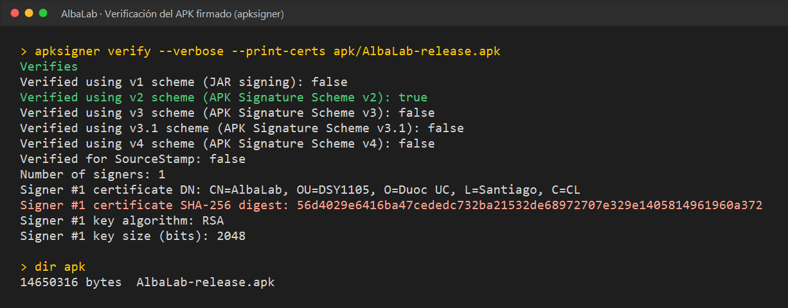
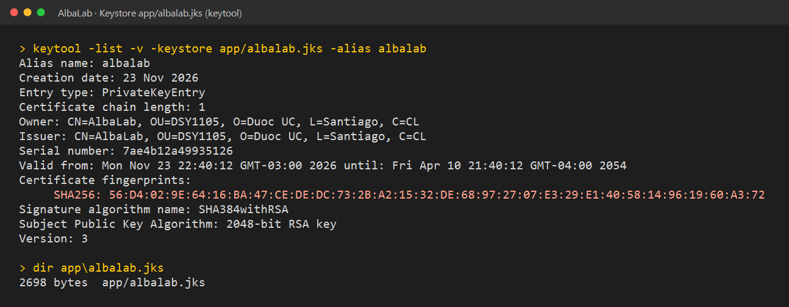

# AlbaLab

App Android para **CORPALIV / Alba Lab**, organización sin fines de lucro que promueve la autonomía y la inclusión social y laboral de personas con discapacidad múltiple. La app reúne en un solo lugar el propósito de la organización, sus programas y su catálogo, y permite que una persona o empresa interesada envíe un **registro de interés** (donación, alianza, voluntariado, compra de productos o capacitación). El equipo de vinculación revisa, actualiza el estado y gestiona esas solicitudes desde la misma app.

La app se conecta a **microservicios propios en Spring Boot** (repositorio [AlbaLab-backend](https://github.com/braliaga/AlbaLab-backend)) y consume **dos APIs externas** (mindicador.cl y Nager.Date).

Proyecto de la asignatura DSY1105 · Desarrollo de Aplicaciones Móviles (Duoc UC) · Evaluación Parcial 4.

## 1. Nombre del proyecto

**AlbaLab** · Kotlin + Jetpack Compose (MVVM) · minSdk 24 · targetSdk 37.

## 2. Integrantes

- Branco Aliaga
- Paulo Catalán

## 3. Funcionalidades

**Contenido institucional (desde ms-contenidos)**
- Inicio, Programas e Impacto y Catálogo Solidario se cargan desde el microservicio `ms-contenidos`. Si el backend no responde, la app muestra una copia local (`ContenidoFicticio`) y nunca queda vacía.
- **Datos de hoy** en Inicio: UF y dólar del día (API externa **mindicador.cl**) y el **próximo feriado** (API externa **Nager.Date**).
- En el Catálogo, cada precio muestra su equivalente en UF y US$ con los valores del día.

**Solicitudes de colaboración: CRUD completo contra ms-vinculacion**
- **Crear:** formulario "Quiero colaborar" (texto, número, fecha, radios, checkbox, switch y foto opcional). Valida cada campo con ícono y mensaje, envía la solicitud al servidor (estado `RECIBIDA`) y, solo si el servidor la confirma, muestra una notificación local. Si no hay conexión, el formulario conserva los datos y ofrece "Reintentar envío".
- **Aviso de feriado:** si la fecha de contacto cae en un feriado de Chile, el formulario avisa que el equipo no atiende ese día (informativo, no bloquea el envío).
- **Leer:** "Mis registros" lista las solicitudes del servidor, con buscador por nombre, chips por tipo de ayuda, estado de cada solicitud y botón para actualizar. Room guarda una copia local para mostrarla al instante y sin conexión.
- **Actualizar:** "Editar registro" cambia teléfono, contacto preferido y novedades (`PUT`) y el **estado** de la solicitud (`PATCH`, queda en el historial del servidor).
- **Eliminar:** con un diálogo de confirmación que nombra el registro (`DELETE`).

**Seguridad del equipo de vinculación**
- Entrar a "Mis registros" exige **biometría** del dispositivo (huella o PIN) y luego **login de gestor** contra `ms-auth`. El token JWT se adjunta a cada llamada; si expira, la app vuelve al login.

**Experiencia**
- Identidad visual de [albalab.corpaliv.cl](https://albalab.corpaliv.cl/): paleta de marca en modo claro y oscuro, fuentes Josefin Sans y DM Sans.
- Barra de navegación inferior (o `NavigationRail` en horizontal), transiciones y animaciones cortas que respetan "Quitar animaciones".
- Todas las llamadas remotas manejan errores con mensajes en español y opción de reintento: la app no se cierra si el backend o internet fallan.

**Bonus tracks**

| Bonus | Dónde |
|---|---|
| Rotación de pantalla | Todas las pantallas: 2 columnas en Inicio y Catálogo, rail en horizontal, estado conservado |
| Autenticación biométrica | `utils/Biometria.kt`, exigida en todo acceso a Registros |
| Notificaciones locales | `utils/Notificaciones.kt`, al confirmar el servidor un registro |
| Filtros dinámicos | `RegistrosViewModel` + buscador y chips en `PantallaMisRegistros` |

## 4. Endpoints utilizados

### Microservicios propios (vía api-gateway `http://10.0.2.2:9090/`)

| Método | Endpoint | Microservicio | Uso en la app | Token |
|---|---|---|---|---|
| POST | `/auth/login` | ms-auth | Login del gestor | No |
| GET | `/programas`, `/casos`, `/productos`, `/indicadores`, `/destinos` | ms-contenidos | Inicio, Programas, Catálogo | No |
| POST | `/solicitudes` | ms-vinculacion | Enviar formulario de interés | No |
| GET | `/solicitudes` | ms-vinculacion | Lista de "Mis registros" | Sí |
| PUT | `/solicitudes/{id}` | ms-vinculacion | Editar datos de contacto | Sí |
| PATCH | `/solicitudes/{id}/estado` | ms-vinculacion | Cambiar estado (queda en historial) | Sí |
| DELETE | `/solicitudes/{id}` | ms-vinculacion | Eliminar solicitud | Sí |

Usuario gestor de prueba: **`gestor@albalab.cl`** / **`Alba2026!`** (lo crea `ms-auth` al iniciar).

### APIs externas (Retrofit, clientes separados de los microservicios)

| API | Endpoint | Uso |
|---|---|---|
| mindicador.cl | `GET https://mindicador.cl/api` | UF y dólar del día en Inicio y equivalencias en el Catálogo |
| Nager.Date | `GET https://date.nager.at/api/v3/PublicHolidays/{año}/CL` | Aviso de feriado en el formulario y próximo feriado en Inicio |

## 5. Pasos para ejecutar

1. **Backend** (repositorio `AlbaLab-backend`): con **Docker Desktop** abierto, en la carpeta del repositorio:
   ```
   docker compose up --build -d
   ```
   Levanta MySQL y los 4 servicios (gateway en el puerto 9090). Ver su README para más detalle.
2. **App:** abrir esta carpeta en **Android Studio**, esperar el Sync de Gradle e iniciar un emulador (API 24 o superior).
3. Presionar **Run**. En Android 17 la app pide el permiso de **dispositivos cercanos / red local**: es necesario para conectarse al backend que corre en el PC. Si se niega, la app funciona con el contenido local.
4. Para entrar a **Registros**, el emulador necesita un bloqueo de pantalla (por ejemplo `adb shell locksettings set-pin 1234`). Después: biometría (PIN) → login con el gestor de prueba.

**Teléfono físico:** cambiar `API_BASE_URL` en `app/build.gradle.kts` por la IP del PC en la red (por ejemplo `http://192.168.1.10:9090/`) y agregar esa IP en `res/xml/network_security_config.xml`.

### Tests y cobertura

```
./gradlew testDebugUnitTest            # 66 pruebas unitarias (JUnit + MockK + coroutines-test)
./gradlew jacocoLogica                 # reporte de cobertura de la lógica
./gradlew connectedDebugAndroidTest    # prueba instrumentada de Room (requiere emulador)
```

El reporte queda en `app/build/reports/jacoco/jacocoLogica/html/index.html`. Mide ViewModels, repositorios, la capa remota (`llamarApi`, `Sesion`) y los formatos. Excluye la UI de Compose, el código generado y las DTOs. **Cobertura actual: 97,1 % de líneas y 91,8 % de ramas.**

En Windows, si la terminal indica que `JAVA_HOME` no está definido, apuntarlo al JDK de Android Studio (`<carpeta de Android Studio>/jbr`).

## 6. APK firmado y llave

- **APK firmado:** [`apk/AlbaLab-release.apk`](apk/AlbaLab-release.apk) (firma APK Signature Scheme v2, verificada con `apksigner verify`).
- **Llave:** [`app/albalab.jks`](app/albalab.jks), alias `albalab`, válida por 10.000 días.
- **Configuración:** `signingConfigs.release` en [`app/build.gradle.kts`](app/build.gradle.kts), que lee [`keystore.properties`](keystore.properties).
- Para regenerarlo: `./gradlew assembleRelease` → `app/build/outputs/apk/release/app-release.apk`.

> En un proyecto real la llave y sus contraseñas **no** se suben al repositorio; aquí se incluyen porque la evaluación lo exige.

**Capturas:**

Verificación de la firma del APK con `apksigner`:



Contenido del keystore con `keytool`. La huella SHA-256 del certificado (`56:D4:02:9E…A3:72`) es la misma con la que está firmado el APK:



## Arquitectura

Patrón **MVVM** con repositorios que reciben sus dependencias por constructor (así se reemplazan por MockK en los tests).

```
cl/duoc/albalab/
├── data/
│   ├── model/        RegistroInteres (caché Room), EstadoSolicitud, TipoAyuda, ContactoPreferido, Contenido
│   ├── local/        RegistroDao, AppDatabase (Room), ContenidoFicticio (respaldo local)
│   └── remote/       ApiAlbaLab, ApiMindicador, ApiFeriados (Retrofit), RedAlbaLab, Sesion (JWT),
│                     ErrorApi + llamarApi (errores → mensajes), dto/
├── repository/       RegistroRepository, ContenidoRepository, AuthRepository,
│                     IndicadoresRepository, FeriadosRepository
├── viewmodel/        Validaciones, RegistroViewModel, RegistrosViewModel, EdicionViewModel,
│                     ContenidoViewModel, LoginViewModel
├── utils/            Biometria, Notificaciones, ImagenStorage, FormatoClp
└── ui/               theme/, navegacion/AppNavegacion, componentes/, screens/
```

- `ms-vinculacion` es la fuente de verdad de las solicitudes; Room guarda una copia para mostrar la lista al instante y sin conexión.
- `llamarApi` envuelve cada llamada en `Result` y traduce cualquier falla (sin red, 401, validación del servidor) a un mensaje en español.

## Recursos nativos y permisos

| Recurso | Uso | Permiso |
|---|---|---|
| Cámara | Foto de perfil del registro (`TakePicture`) | `CAMERA`, en tiempo de ejecución |
| Galería | Elegir una foto existente (`GetContent`) | Ninguno |
| Internet | Microservicios, APIs externas e imágenes (Coil) | `INTERNET` |
| Red local | Conectarse al backend del PC (Android 17+) | `ACCESS_LOCAL_NETWORK`, en tiempo de ejecución |
| Biometría | Proteger el acceso a los registros | Bloqueo configurado en el dispositivo |
| Notificaciones | Avisar que el registro se guardó | `POST_NOTIFICATIONS` (Android 13+), al abrir el formulario |

- El tráfico HTTP sin cifrar se permite **solo** hacia `10.0.2.2` y `localhost` (`network_security_config.xml`); las APIs externas usan HTTPS.
- Si se deniega cualquier permiso, la función afectada muestra un aviso y el resto de la app sigue funcionando.

## Nota sobre los datos

Todos los datos de la app, del backend y de los tests son **ficticios** o anonimizados. Las imágenes remotas provienen de un servicio público de fotos de ejemplo sin relación con la organización ni con personas reales.
